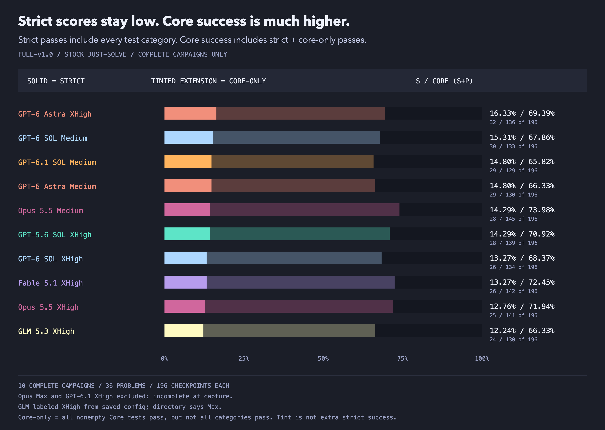
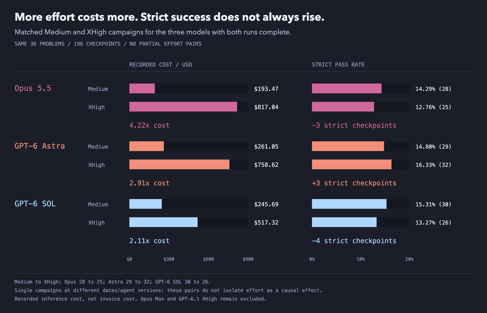
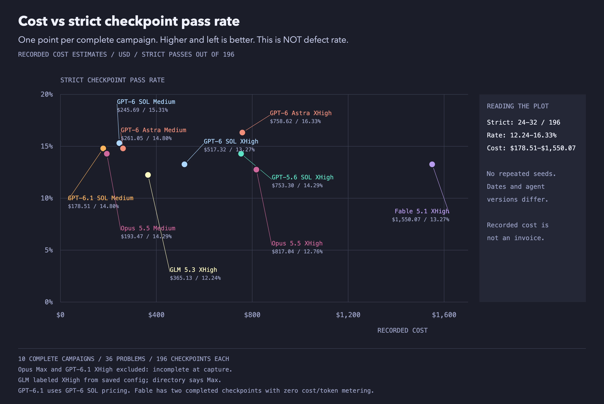
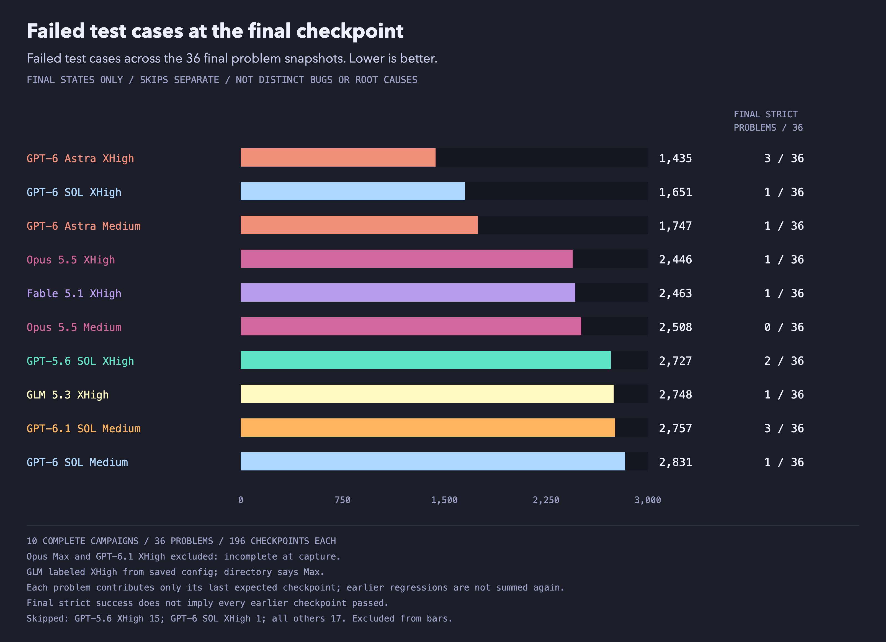
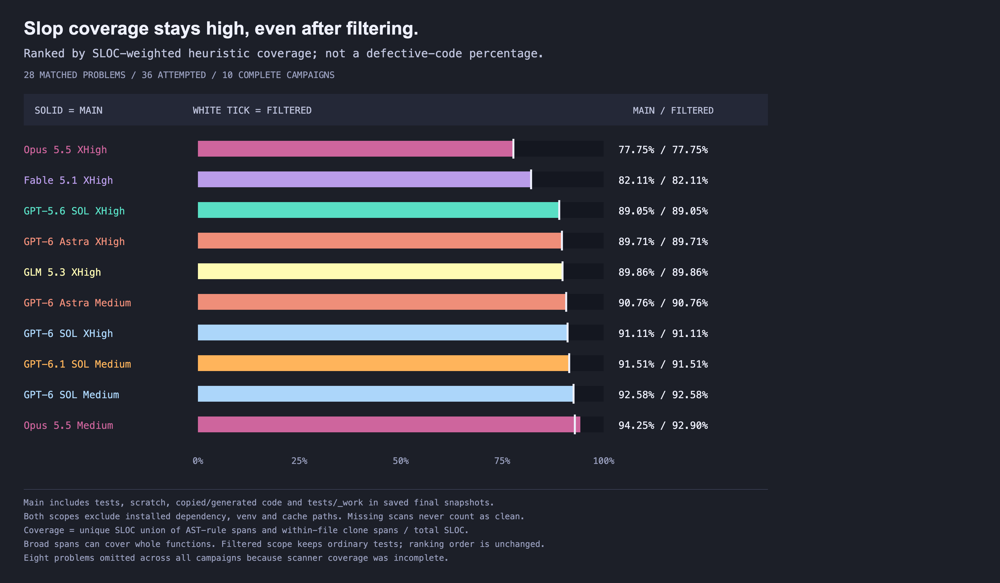
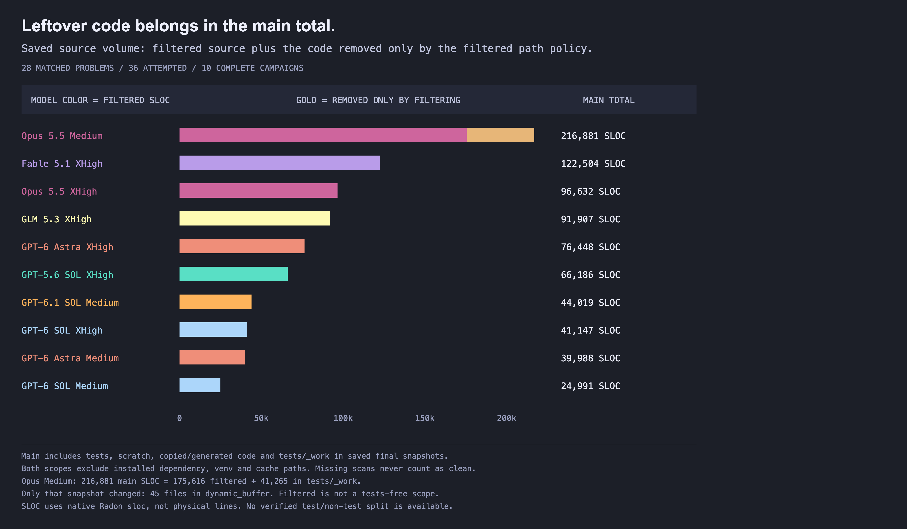
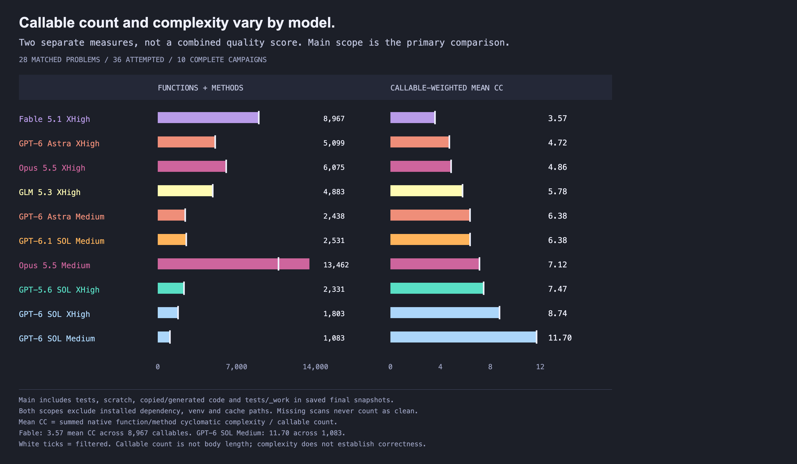

# SlopCodeBench update 10/2026 - Astra improves by 1.5% over gpt-5.5, xhigh considered harmful

> **NOTE:** This is Part I of our findings on recent models: the Q4 state of the slop. Gabe and the [SlopCodeBench team](https://arxiv.org/abs/2603.24755) will share their analysis and a more qualitative deep dive into slop patterns in Part II.

In May, gpt-5.5 got a 14.8% strict pass rate on slopcodebench. This month, I ran the frontier models through the same campaigns, and the highest scorer was gpt-6 astra, hitting 16.3%. 

The agents pass the Core tests at **65.8-74.0%** of checkpoints. Require every test category to pass, including regressions, and that falls to **12.2-16.3%**.

That's the main result from my latest SlopCodeBench runs on: 

- Opus 5.5
- Fable 5.1
- SOL 6 and 6.1
- Astra
- GLM 5.3

They often get the main behavior right without getting everything right. And higher effort isn't a reliable fix: XHigh costs **2.11-4.22x** as much as Medium in the three complete pairs, and most notably, **opus 5.5 did *BETTER* on medium effort than on xhigh**

Over the past few months I was running subsets of the bench, I [started with three problems](./benchmarking-opus-5-on-slop-code-bench.md), then [tried six](./benchmarking-sol-fable-kimi-on-slop-code-bench.md). This time: **36 problems and 196 checkpoints per setting**. The earlier subsets don't establish improvement or decline; this is a broader test, that lets us compare against the official research findings.

## what I ran

[SlopCodeBench](https://arxiv.org/abs/2603.24755) gives a coding agent a problem in stages. It writes a program, gets new requirements, and changes the existing code. Later checkpoints test both new behavior and old behavior.

Getting the next feature mostly right isn't enough if the old ones stop working.

I used the pinned v1.0 catalog, the stock `just-solve` prompt, seed 42, the `any-case` runner pass policy, and Docker with Python 3.12 and uv. 

Each model,effort pair gets one campaign. Checkpoints within a problem build on earlier code, so 196 checkpoints are not 196 independent trials. Problems also have different numbers of checkpoints. These rates weight checkpoints equally, not problems equally.

The snapshot is **October 4, 2026 at 03:08:58 UTC**. Fable is complete. Opus 5.5 Max and GPT-6.1 SOL XHigh were still ongoing; stay tuned for those results soon.

## Core vs. Strict pass rates

- **Strict:** every test category passes, including Regression. 
- **Core:** all tests in a nonempty Core category pass. For example, if a model fails checkpoint 2, it can still get a core pass for a later checkpoint, even if the ck2 tests remain failing.

*Strict passes: 24-32 of 196. Core passes, including strict: 129-145. The tinted portion isn't extra strict success.*

| Complete campaign | Strict passes | Strict rate | Core rate | Estimated cost |
| --- | ---: | ---: | ---: | ---: |
| GPT-6 Astra XHigh | 32/196 | 16.33% | 69.39% | $758.62 |
| GPT-6 SOL Medium | 30/196 | 15.31% | 67.86% | $245.69 |
| GPT-6 Astra Medium | 29/196 | 14.80% | 66.33% | $261.05 |
| GPT-6.1 SOL Medium | 29/196 | 14.80% | 65.82% | $178.51 |
| Opus 5.5 Medium | 28/196 | 14.29% | 73.98% | $193.47 |
| GPT-5.6 SOL XHigh | 28/196 | 14.29% | 70.92% | $753.30 |
| Fable 5.1 XHigh | 26/196 | 13.27% | 72.45% | $1,550.07 |
| GPT-6 SOL XHigh | 26/196 | 13.27% | 68.37% | $517.32 |
| Opus 5.5 XHigh | 25/196 | 12.76% | 71.94% | $817.04 |
| GLM 5.3 XHigh | 24/196 | 12.24% | 66.33% | $365.13 |

Fable's recorded total includes two completed checkpoints with zero cost and zero token metering despite recorded agent steps. Its score is sound, but $1,550.07 is not a verified full economic cost.

Astra XHigh has the most strict passes in this snapshot. But it's lead over SOL 6.1 Medium is only **two checkpoints**.

Opus Medium leads Core success at **145/196**, but passes only **28/196** strictly. 

## more effort == more spend, but not necessarily better outcomes

*XHigh costs more in all three pairs; strict success rises only for Astra. These single runs don't isolate effort as the cause.*

| Model | Strict: Medium → XHigh | Core: Medium → XHigh | Estimated cost multiplier |
| --- | ---: | ---: | ---: |
| Opus 5.5 | 28 → 25 | 145 → 141 | 4.22x |
| GPT-6 SOL | 30 → 26 | 133 → 134 | 2.11x |
| GPT-6 Astra | 29 → 32 | 130 → 136 | 2.91x |

This doesn't prove that more reasoning hurts coding. It says **higher effort was not a reliable way to buy more strict passes in these runs**. One campaign per setting can't tell me how much is run-to-run variation.

*Recorded estimates span $178.51-$1,550.07 within a 12.24-16.33% strict-score range.*

GPT-6.1 Medium has the lowest recorded cost at $178.51, with the same strict count as Astra Medium. Fable's recorded estimate is about **8.68x** as much, with three fewer strict passes. 

## the final code still fails tests

Checkpoint success also isn't the same as ending with a working program.

*Only each problem's last checkpoint counts here. Failed test cases aren't distinct bugs; skips stay separate.*

| Complete campaign | Strict final checkpoints, out of 36 | Final failed test cases | Of those, Regression |
| --- | ---: | ---: | ---: |
| GPT-6 Astra XHigh | 3 | 1,435 | 1,178 |
| GPT-6 Astra Medium | 1 | 1,747 | 1,516 |
| GPT-6 SOL XHigh | 1 | 1,651 | 1,366 |
| GPT-6 SOL Medium | 1 | 2,831 | 2,479 |
| GPT-6.1 SOL Medium | 3 | 2,757 | 2,404 |
| GPT-5.6 SOL XHigh | 2 | 2,727 | 2,376 |
| Fable 5.1 XHigh | 1 | 2,463 | 2,126 |
| Opus 5.5 Medium | 0 | 2,508 | 2,206 |
| Opus 5.5 XHigh | 1 | 2,446 | 2,123 |
| GLM 5.3 XHigh | 1 | 2,748 | 2,311 |

## code quality: count what gets left behind

My first reaction was to remove the random temp files from the quality scores. But the researchers made a good point: **the benchmark should measure how much garbage models leave in the codebase. If we're not reading the code, we need to measure it.** Tests, scratch code, and generated copies don't get a free pass just because they aren't the main program.

So the main count uses all source the benchmark's native scanner measures in the saved final code, including tests and `tests/_work`. Both the main count and a separate filtered comparison exclude declared installed-dependency, virtual-environment, and cache paths. None of those paths matched source files here; that doesn't prove we've found every possible custom dependency folder. We're measuring saved output, not external evaluator files, and not proving that every file was model-authored.

These figures cover **28 matched problems across ten complete campaigns**, not all 36 problems. Eight problems lack reliable scanner coverage, so we leave them out for every campaign. Missing measurements aren't clean code.

*Main coverage, lowest first. The filtered comparison leaves the order unchanged. These are heuristic percentages, not percentages of defective lines.*

Coverage counts unique source lines covered by the scanner's pattern-rule spans or within-file clones, then divides by total source lines (SLOC). A rule can cover a whole function; it doesn't mean every covered line is broken. We sum covered lines and SLOC across problems before dividing, so larger programs count more. **This is SLOC-weighted, not the mean of per-problem percentages used in the earlier posts.**

Opus XHigh has the lowest coverage at **77.75%**, versus **94.25%** for Opus Medium, despite worse strict checkpoint scores: 25 versus 28. Less flagged code and more passing checkpoints are different results. I'm not combining them into an overall model ranking.

*Opus Medium has the largest source total with or without filtering. The removed portion is not all test code.*

The filtered check removes only named folders: `_work`, `tmp`, `temp`, `scratch`, `generated`, `build`, and `dist`, plus `*_pb2.py` and `*_pb2_grpc.py` files. It doesn't try to guess which code looks generated, and it doesn't remove tests as a group. Here, only `_work` matched: **45 files and 41,265 SLOC**, all in Opus Medium's final `dynamic_buffer` snapshot. Its total falls from **216,881 to 175,616 SLOC**, and coverage falls to **92.90%**. The coverage ranking stays the same; every other campaign's counts stay the same too.

*Fable has the lowest mean complexity, 3.57; GPT-6 SOL Medium has the highest, 11.70. Functions and methods each get one vote.*

More helpers can lower average complexity without making the code easier to change. Smaller code isn't automatically better either. These measurements tell us what remains in the saved codebase; they don't replace reading it or checking whether it works.

## my takeaway

The full benchmark is hard in a way that matters to me: the agents get the main behavior right much more often than they keep **all** tested behavior working as requirements change.

We're getting better at maintaing a codebase over time (14.8% to 16.3% during may->september), but not as fast as anyone would have you believe. I think we'll be keeping the lights on for a while to come.

> **NOTE:** This is Part I of our findings on recent models: the Q4 state of the slop. Gabe and the [SlopCodeBench team](https://arxiv.org/abs/2603.24755) will share their analysis and a more qualitative deep dive into slop patterns in Part II.
