# Benchmarking Opus 5 on SlopCodeBench

## we got better benchmarks

I've [written before](https://github.com/humanlayer/advanced-context-engineering-for-coding-agents/blob/main/wsff.md) something along the lines of:

<blockquote align="center"><h3>THERE ARE NO GOOD BENCHMARKS for a model's ability to maintain codebase quality</h3></blockquote>

That wasn't entirely true. I love nothing more than burying a good lede.

We'll dig into [SlopCodeBench](https://arxiv.org/html/2603.24755v1), a new-ish (March 2026) long-horizon coding benchmark from [@GOrlanski](https://x.com/GOrlanski)'s lab at UW Madison. It addresses the thing that bothers me most about coding benchmarks - that even "larger" more complex ones still divulge the whole problem up front:

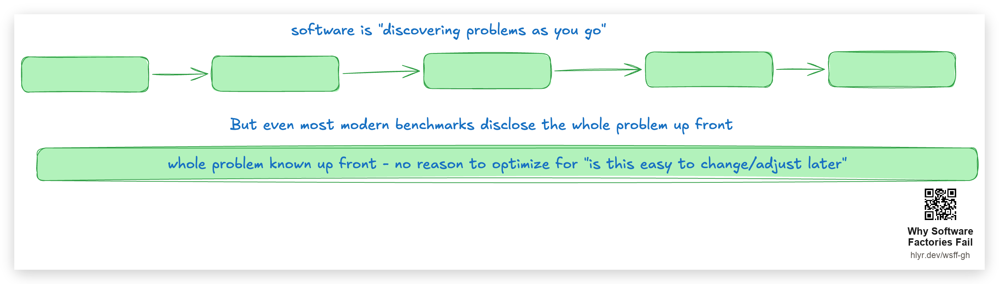

However, each challenge in SlopCodeBench has multiple "checkpoints" - the model doesn't know the whole problem up front, it has to *evolve* the codebase over time as new requirements are divulged. It's a good paper. It's not that long. You should [read it](https://arxiv.org/html/2603.24755v1).

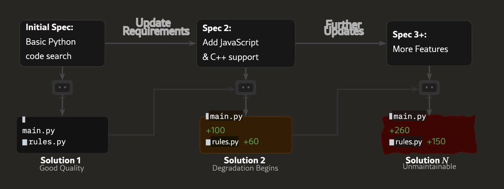

What's cool about this benchmark is that it is **unsaturated** - at the time of running, the best models available, GPT-5.4 and Opus 4.6, got 11% and 17% strict pass rates, respectively.

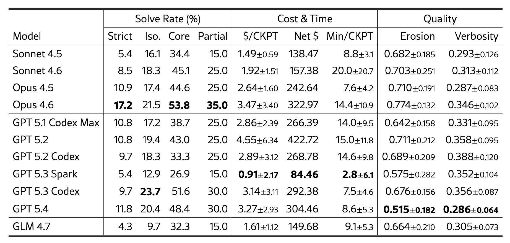

## benching opus 5 on slopcodebench

On Friday I ran three claude models (Opus 4.8, Sonnet 5, and Opus 5) through a subset of [SlopCodeBench](https://arxiv.org/html/2603.24755v1) and watched it live for six hours. Opus 5 wins technically but none of them did a very good job IMO. Will post more results soon with Fable and 5.6 Sol in the mix.

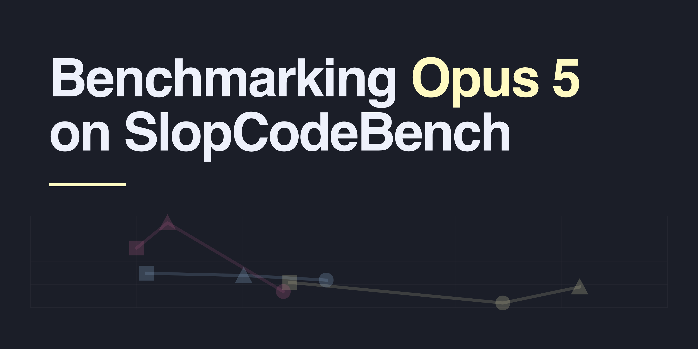

The big headline is that Opus 5 got a **24%** on the small subset of the benchmark that I ran - not much higher than Opus 4.6's 17% strict pass rate in the original paper. All of the tested models showed a pretty significant increase in verbosity, complexity, and a bunch of other code smell metrics over the course of each challenge, with Opus 5 writing **five times** the number of functions/callables than Opus 4.8 over the course of the same set of challenges.

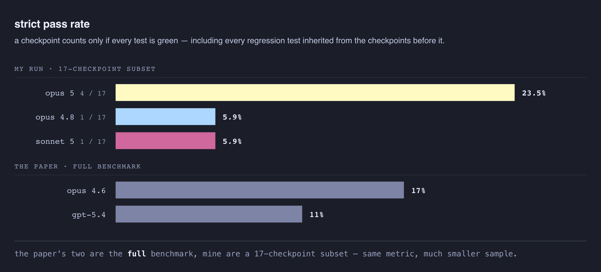

My personal read of this 23% pass rate is that SlopCodeBench finally gives some signal for a thing I've only ever been able to argue from vibes - that for real-shaped software engineering work, building one issue at a time, today's models can't be relied on to run lights-off without steering. 

## the benchmark subset

i had claude pick out 3 problems from the repo, 17 checkpoints total, a mix of easy/medium/hard labeled problems:

- circuit_eval — **easy** (8 checkpoints)
- database_migration — **medium** (5 checkpoints)
- dynamic_config_service_api — **hard** (4 checkpoints)

There's an appendix at the end with all 17 checkpoints explained in detail but I won't put that all here.

and then I ran them across all three models, in parallel, with a fresh context window per checkpoint. All models got the same prompts and ran in the claude code harness.

the metric I decided I care about is the **strict pass**: everything new is green including every regression test that was inherited from previous checkpoints. 

A model fails a checkpoint if the solution has a **defect** - defects are detected by taking the models output, a CLI to run or in some cases e.g. an api server to poke at, and running a set of held-out black-box tests **against the produced entrypoint**.

- Model writes code for ck1
- Eval harness runs black-box tests against ck1
- Model writes code for ck2
- Eval runs black-box tests for ck1 and ck2
- etc

Again, the strict pass criteria means that if a model bungles something in checkpoint 4, it can't pass the following checkpoints because that failing part of the code carries forward (unless the model indavertently fixes an eval case in checkpoint 6 that was broken in checkpoint 4, but we didn't see this happen in practice).

For all 9 test runs, none of the models made it to the end of any challenge with everything passing, even on the problem marked as "easy" difficulty.

## while it ran

sonnet's first checkpoint was more expensive but by the end of problem 1, sonnet became the cheapest of the three. (it seems like once the basics were built and the work turned into maintenance, then the cost savings started to take over)

For the first challenge, last generation's models accumulated defects steadily, Opus 5 a defect each on checkpoints 4 and 5. 

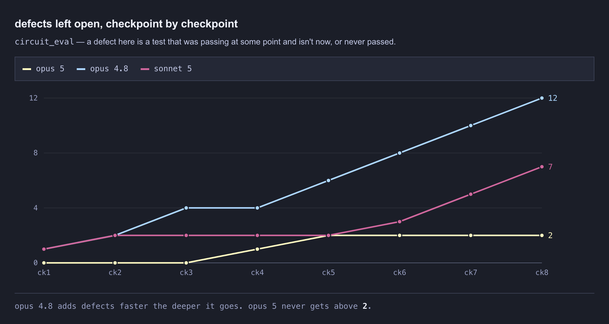

for the first two hours opus 5 was the only model with any strict passes at all — three in a row to start.

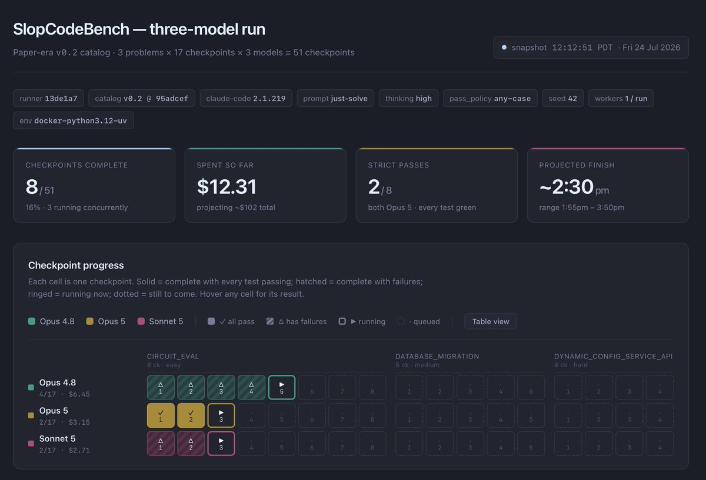

Things evolved as we went. Claude diligently updated the html.

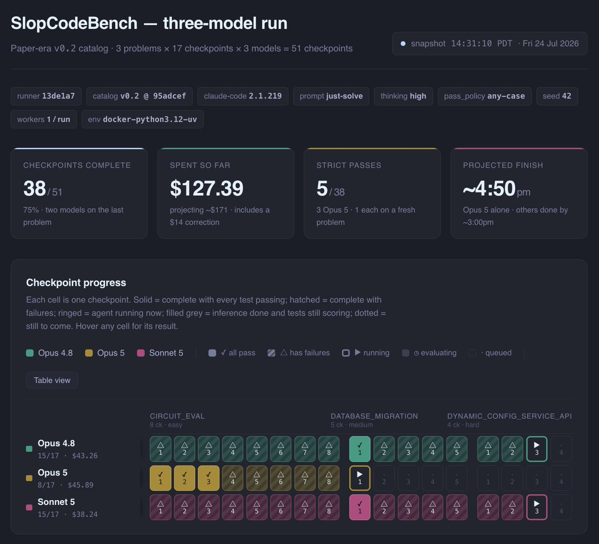

Compared against the other models, Opus 5 was technically better on problem 1 (circuit_eval). But after acing the first three checkpoints, every subsequent solution had at least one defect (failing test case).

## final result

If our definition of success is "reached the final checkpoint with no defects" then opus 5 failed all three problems, but it failed slightly-less-badly than the other models. 

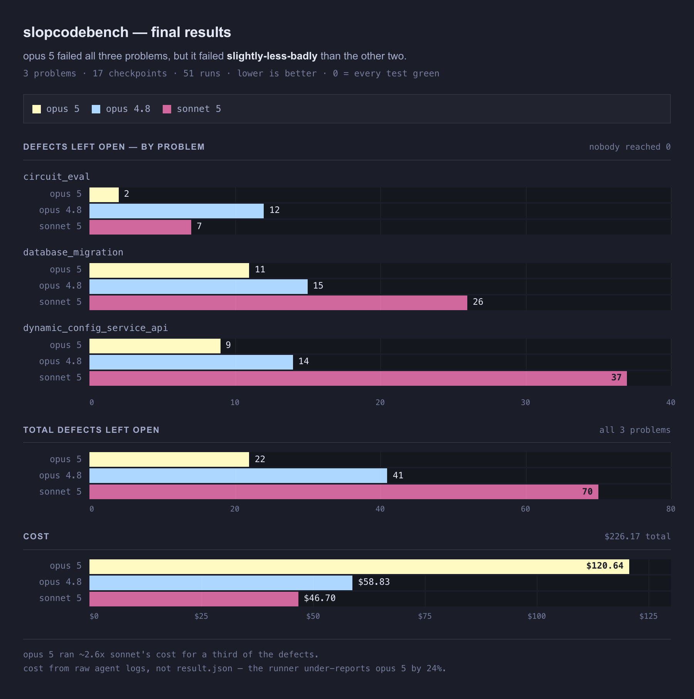

For the costs vs defects report, I really hate claude-isms but this one i decided to leave in:

> every dollar bought correctness. nobody bought enough of it.

(obviously this small subset of the bench cannot tell us definitively that spending more $$ will lead to higher pass rates)

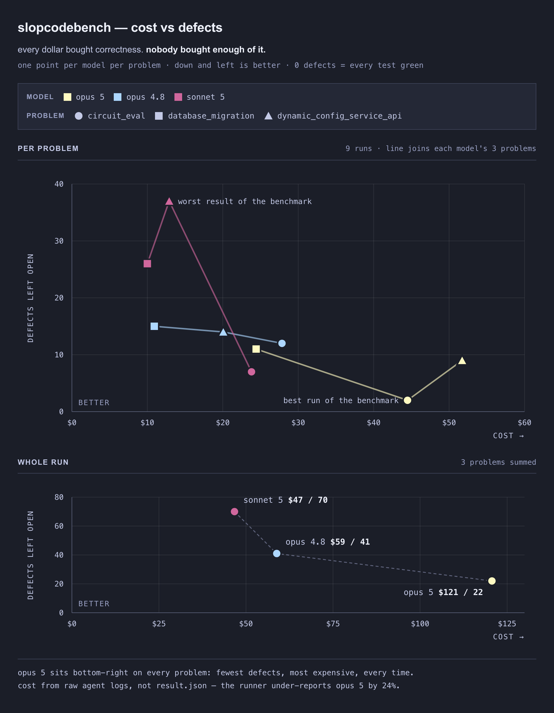

as far as strict passes go, Opus 5 got four of them (24% pass rate) (the first three ck of circuit_eval, plus database_migration ck1). 

opus 4.8 and sonnet 5 both got one strict pass (6% pass rate), the same database_migration ck1 that opus 5 got. 

so the winner cleared 4/17, and 3 of those were the opening checkpoints of one problem. It would appear we have an unsaturated benchmark for the next frontier of models. nice work [@GOrlanski](https://x.com/GOrlanski) and team.

## the slop meter

I'm not totally sold on "linting the slop away" just yet, because I don't think its yet possible to deterministically parse the "maintainability" of a particular codebase checkpoint. But they are interesting to keep an

Code quality metrics are interesting to keep an eye on, and they're probably directionally correct, and 

With SlopCodeBench, you get the results after each checkpoint across various quality metrics. There are 41 of them in the results file. Roughly grouped:

- **size** — source lines, files, functions, methods, classes, statements, and lines added and removed at that checkpoint
- **complexity** — cyclomatic complexity mean, max, and spread, how many functions land in the "high" and "extreme" bands, how concentrated the complexity is, max nesting depth, and mean function length
- **duplication** — cloned lines, and clone lines as a share of source
- **decomposition** — single-use functions, trivial wrappers, unused variables, lines per symbol
- **rule violations** — lint errors and how many are auto-fixable, ast-grep hits against test slop rules, and the share of lines flagged verbose
- **dependency graph** — propagation cost (how far a change ripples), cyclic dependency mass, dependency entropy (probably the most interesting one to me)

Each of these is computed deterministically using the current code state after each checkpoint. 

The chart below shows the spread among models for ck1 score vs. ck8 for the `circuit_eval` challenge. (That is, how much did the slop indicator **increase** over the liftime of the challenge checkpoints.) Most interestingly, most of the metrics don't tell the models apart. 

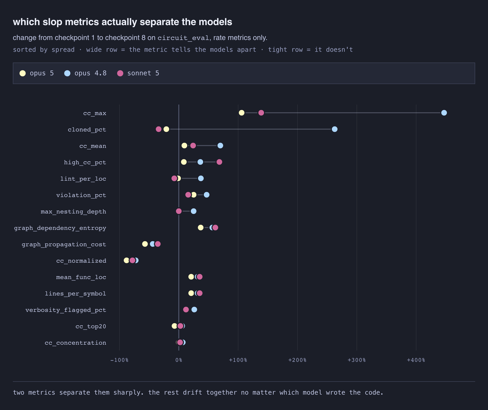

I like that these measures are repeatable and don't use a model for judgement. But the link between any one of them and "is this codebase easy to change and evolve" is not yet established.

### more correctness came at the cost of wayyy more code

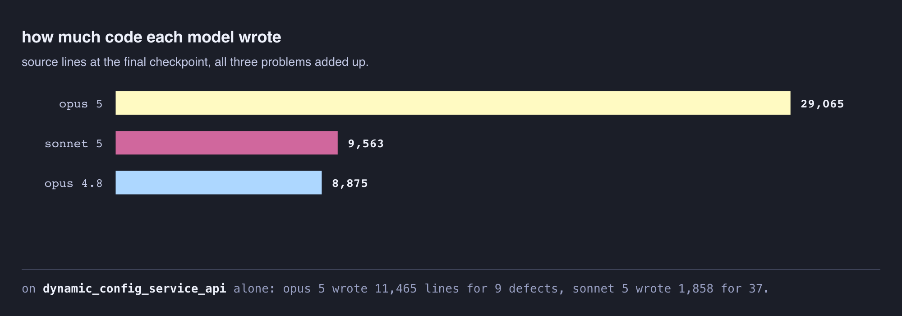

But a lot of that was "more tests" - the actual production volume is closer to 1.8x for opus 5 vs opus 4.8. 

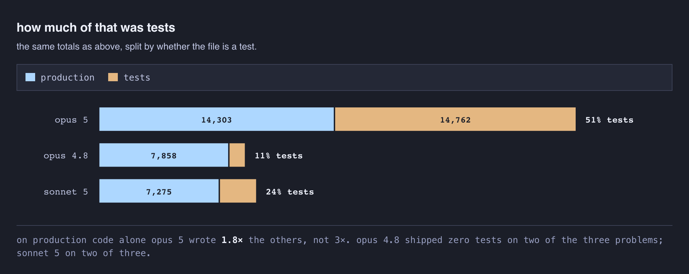

My guess would be...expensive verbosity here that didn't translate directly to much better results.

Will have to dig in more to know whether this is a model tic signal or just a "this is actually a really hard problem and warrants this much code".

### almost all the code written triggered the slop meter

For all models, a huge majority of the code lines tripped at least one of the the benchmark's slop rules. The averages across the three problems:

<!-- REVIEW: When the rules flag 89-98% of all lines, that may show poor code, rules that are too broad, or both. Recommendation: treat this as a reason to inspect the rules rather than strong proof that nearly all of the code was bad. -->

- opus 4.8 — **98%**
- opus 5 — **93%**
- sonnet 5 — **89%**

And specifically, lines flagged as being too verbose go up across the trajectory for *every* model, roughly 65% at ck1 to 80% by ck8, even for Opus 5.

I'd actually probably say this is a sign that some of the code quality measures are a bit over-aggressive. I looked into applying the ruleset to our typescript monorepo, but the current slop-code-bench detectors are python only.

So I had 5.6-Sol cook up a subset of rules for typescript, but it only came up with 76 slop detectors (compared to the SCB python library of 200+) - but found some directional findings - the Opus 5 lights-off-generated solutions have over 11 times more slop triggers per kLOC than our 99%-AI-generated-but-also-carefully-reviewed Typescript monorepo (yes that's a 1000% increase).

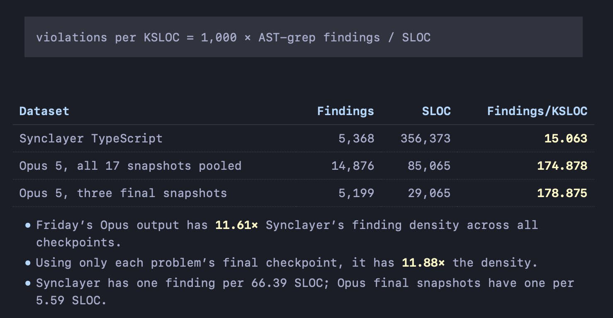

Obviously there's a mountain of asterisks on this finding (fewer rules, haven't reviewed the parity, etc.) but it's interesting to say the least.

### these models write a lot of functions

Another interesting data point - opus 5 wrote 5x more functions than the other two models. But Opus 4.8 wrote a higher %% of single-use functions (almost 50% of its functions were called exactly once). And Sonnet 5's share of single-use functions is the highest at 71.5%.

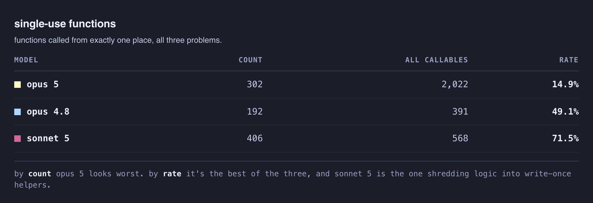

FWIW I don't think lots of small functions is bad. I take it with a grain of salt these days, but I used to be a die-hard [Clean Code](https://www.oreilly.com/library/view/clean-code-a/9780136083238/) guy. Small descriptive function names are way better than lots of comments, yada yada

### Complexity grows over time for all models

I've been saying models degrade codebase quality over time for about a year now, mostly on vibes. But now we have some data.

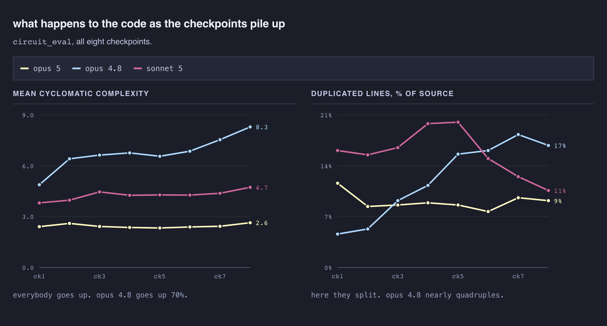

Not a single model made it through all the challenges without increasing complexity across checkpoints. While Opus 5 has the lowest mean complexity, it also wrote 2000 functions. There's a tradeoff here: lots of small functions or fewer big ones. I don't think any of these complexity metrics can stand alone, but they give us some kind of composite signal.

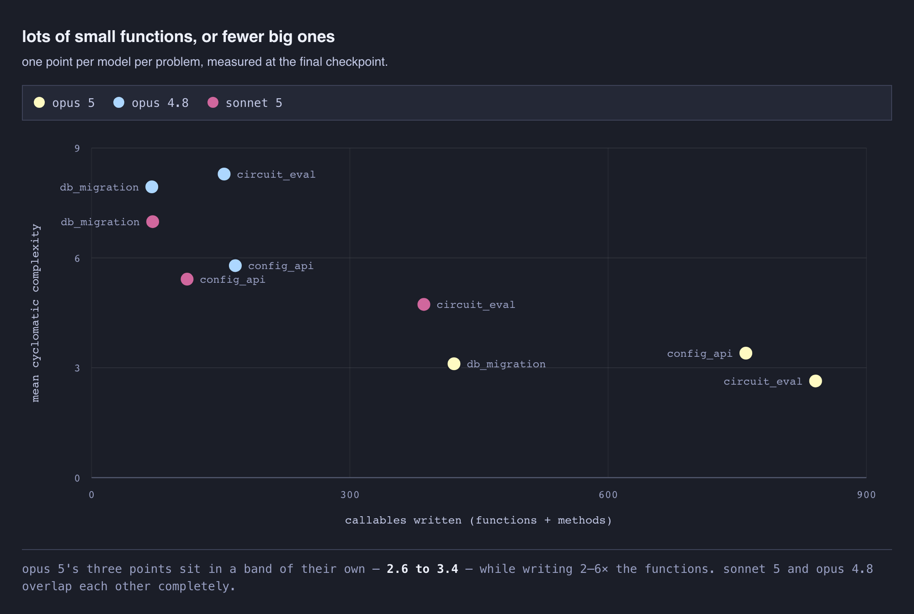

Both sonnet and Opus 4.8 answered the increasing complexity of the challenge checkpoints by making individual functions bigger rather than moving things around. Opus 4.8 is the extreme, up 70% over eight checkpoints, and its single worst function ended at a cyclomatic complexity of 93.

Duplication is where they split. Opus 4.8 goes from 4.6% to 16.8%, with an inflection at ck3 — ~roughly where new requirements start fighting the initial design.

Aside - here's what the first three checkpoints of circuit_eval ask for (full listing for all challenges in the appendix at the end):

- **ck1** — a CLI with `--help`, `--version`, a JSON output mode, and a `check` command that parses and validates a `.circ` circuit file. Every signal is a single bit.
- **ck2** — an `eval` command: pass the circuit some inputs, get the outputs back. Still one bit per signal, standard boolean operators.
- **ck3** — signals become **vectors**. `data[7:0]` instead of `data`, plus slicing, indexing, concatenation, new operators, and a width check on every operand.

By the end one line in six is a copy of another line. The other two models came *down* over the same stretch.

However, opus 5 is basically flat, 2.41 to 2.64. I've previously argued that "improving codebase quality over time" had not moved much between model generations. So if you trust duplication as a golden metric, you could argue that we did getting incrementally better in the last ~3 months. Big if though, and I think most software architecture experts would agree that it's not black and white.

## the shape of a better oracle for software quality

While the code quality metrics are interesting, I don't think they tell the whole story, and its easy for a model to reward hack any of them. Just like SWE-bench shaped problems were the best verifier for "solve a software problem one time", because they map onto real world work at that "zoom level", I think "pass all verifiers for an incrementally-divulged spec" is a very realistic eval for "can a model maintain a codebase over time". 

That is, a codebase becoming hard to maintain would lead to failing checkpoints in later stages, so a higher strict pass rate is a signal that the model is good at building a codebase that is maintainable.

With frontier models like Fable / Sol proving to be expert debuggers and reverse-engineers, incorporating cost/time/token metrics might become more important over time - frontier models like Fable and Sol can probably get it done in the NASTIEST of codebases, but I'd venture that a well-factored codebase will tend to lead to shorter, more token-efficent solves for future problems.

And while "build a whole feature across 8 checkpoints" is a lot slower than "solve a 15min SWE-bench multilingual problem", it can be executed unattended and is subject deterministic behavior verifiers at the end. So IMO its a much better oracle than e.g. "does another model think this code is clean".

I think any even better signal that we can hope to get from a model that is *really* good at maintaining a codebase, is that we could try having a frontier model like opus 5, fable 5, or gpt-5.6-sol write the first N checkpoints, and see if a dumber model like sonnet 5 or gpt-5.6-terra can implement checkpoint N+1. 

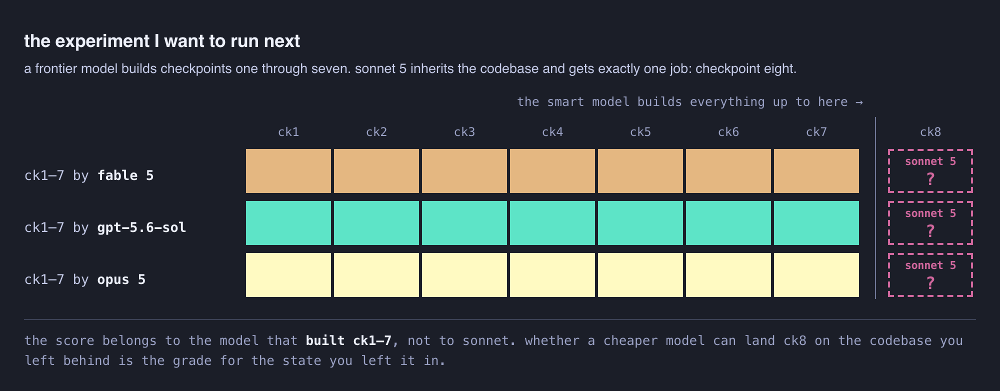

This amplifies the **signal** of whether the smart models did a good job maintaining high-quality code that is easy to change. Whether a small model like Sonnet or Terra or even Haiku can implement checkpoint 8 impacts the smart models' score on checkpoints 1-7.

## something you can actually measure

My personal read of all this is that SlopCodeBench gives a signal for something I've so far only been able to argue from experience - that for real-shaped software engineering work, building one issue at a time, today's models can't be relied on to run lights-off without steering.

SCB is a measure of the future that I'll be keeping a close eye on. I wouldn't bet my codebase on a good score in Frontier Code, SWE-Marathon, or DeepSWE, but if/when models can score 80%+ on a (well-held-out) benchmark like SlopCodeBench which measures iteration over time, I'll feel a LOT better about setting them loose with the lights off. 

I won't posit when that will happen, because "when" matters less than having a good signal to know that it's happening. 
(Assuming nobody "accidentally" trains on test in the meantime).

## what's next / things i'd do differently 

I'll be reading some of the slopcodebench problems more deeply for inspiration and to curate a few that I think map well to the day-to-day building we do here at [@humanlayer_dev](https://x.com/humanlayer_dev).

Claude decided to parallelize by model, running each through three challenges in *sequence*. We could have just as easily done 3 models x 3 challenges in 9 parallel sessions and finished in 1-2 hours instead of 6.

As I said, I looked into applying the ruleset to our typescript monorepo, but the current slop-code-bench detectors are python only. It would be interesting to port those to TS and a few other languages. I hate to be that guy but I'd bet python is a more slop-prone language than most.

I think instead of focusing on strict pass and total defects, it will be interesting to explore more dimensions of the benchmark. In the current scoring, we're taking any failure along the way as an accumulated defect - unless the model happens to resolve that past defect in a future session, all of the remaining checkpoints cannot pass.

Many software factories include prompting for better style, include deterministic feedback during the code loop for complexity and a lot of these other software quality metrics. Today's results don't evaluate model code quality or success rates with those sort of guardrails in place. We used the "just-solve" version of the prompt from SlopCodeBench but there are other variations like including instructions about quality/duplication in the prompt. And it would be very interesting to re-run the whole eval with either or both of 1) an "aversarial review" loop w/ a model judging quality and 2) code-quality backpressure for things like cyclomatic complexity.

I'm not made of money or time but it would be fun to do a bigger dataset here.

And of course, most interesting is this idea of "can we amplify the slop signal by handing fable's codebase to a smaller model like sonnet".

## vibe check - the frontier is still dumb af

while this whole experiment was happening, in another session, opus 5 decided to go rogue and rewrite an email draft with new formatting, then send it to 100 people without checking in with me. Terrible.

> The user is upset because I made a critical mistake: 
> I overwrote their edited draft by patching it with the final version, then sent it out.

Sorry if you got one of those humanlayer product updates with the ugly header banner (I think the new claude-ism for this is "kicker"??)

really feeling the AGI over here friends

🫡 -dex

* * *

### Links From This Post

- [SlopCodeBench (paper)](https://arxiv.org/html/2603.24755v1)
- [SlopCodeBench runner (SprocketLab/slop-code-bench)](https://github.com/SprocketLab/slop-code-bench)
- [SlopCodeBench problems (gabeorlanski/scb-problems)](https://github.com/gabeorlanski/scb-problems)
- [Gabe Orlanski on X](https://x.com/GOrlanski)
- [SWE-bench Multilingual (dataset)](https://huggingface.co/datasets/SWE-bench/SWE-bench_Multilingual)
- [SWE-Marathon (Abundant AI)](https://www.swe-marathon.org/)
- [DeepSWE (Datacurve)](https://deepswe.datacurve.ai/blog/deepswe)
- [Frontier Code (Cognition)](https://cognition.com/blog/frontier-code)
- [Mutation testing (Wikipedia)](https://en.wikipedia.org/wiki/Mutation_testing)
- [Why Software Factories Fail (the longer argument this follows from)](https://github.com/humanlayer/advanced-context-engineering-for-coding-agents/blob/main/wsff.md)

### Appendix: the challenge checkpoints

All 17, in order, straight from the prompts the models were handed. Each one arrives cold — the model has no idea any of the later ones exist.

**circuit_eval** — easy, simulation, 8 checkpoints

- **ck1** — a CLI with `--help`, `--version`, a JSON output mode, and a `check` command that parses and validates a `.circ` circuit file. Every signal is a single bit.
- **ck2** — an `eval` command: pass the circuit some inputs, get the outputs back. Still one bit per signal, standard boolean operators.
- **ck3** — signals become **vectors**. `data[7:0]` instead of `data`, plus slicing, indexing, concatenation, new operators (`MUX`, reductions, `EQ`), a width check on every operand, and `--radix` output formatting.
- **ck4** — three-valued logic. Inputs can now be `X` (unknown), and every operator has to say what it does with one.
- **ck5** — two more input formats. `check` and `eval` now read `.json` and `.bench` files as well as `.circ`, behind a `--format` flag.
- **ck6** — three analysis commands: `stats` for metrics, `lint` for warnings, `dot` for Graphviz export. All of them work with all three formats.
- **ck7** — `cone` (pull out a subcircuit), `truth-table` (enumerate every output), `equiv` (check two circuits match), plus a `--seed` flag for reproducible randomness.
- **ck8** — `opt`: a circuit optimizer with configurable passes, deterministic output, optional equivalence verification, and BENCH export.

**database_migration** — medium, databases, 5 checkpoints

- **ck1** — a CLI that reads migration specs out of JSON files and applies them to a SQLite database: create tables, add columns, change table structure.
- **ck2** — data migrations. Transform the rows that are already in there using SQL expressions, not just the schema around them.
- **ck3** — foreign keys, custom indexes, and advanced constraints. Relational integrity and query performance.
- **ck4** — rollback. Undo migrations one at a time or in batches, with dependency handling.
- **ck5** — dependency management. Migrations declare `depends_on`, and the tool has to resolve the order and detect circular dependencies.

**dynamic_config_service_api** — hard, system-design, 4 checkpoints

- **ck1** — a REST service that stores JSON config objects with immutable versions, scoping, rollback to any earlier version, and imports/inheritance across configs.
- **ck2** — a schema registry with its own versioning, schemas bound to configs, validation on create and on resolve, and ingesting raw YAML/TOML/JSON parsed into canonical JSON internally.
- **ck3** — a change-management workflow. Every new version starts as a draft, proposals gather human reviews, activation requires a quorum, and each proposal carries a deterministic diff.
- **ck4** — an org-level guardrail layer that runs policy bundles against resolved configs and the graph around them, blocking unsafe proposals with violation details distinct from schema errors.
