# Benchmarking Fable, Sol, and Kimi K3 on SlopCodeBench

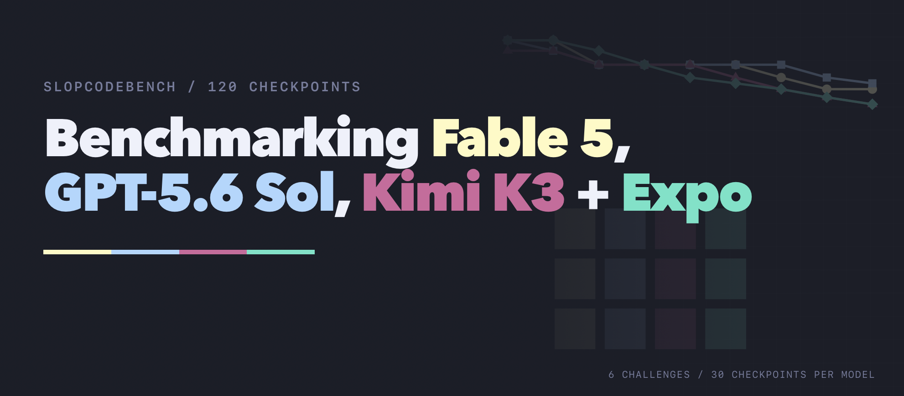

Last week when Opus 5 came out, I [ran some benchmarks](https://github.com/humanlayer/advanced-context-engineering-for-coding-agents/blob/main/benchmarking-opus-5-on-slop-code-bench.md) against my favorite new coding agent eval - [SlopCodeBench](https://arxiv.org/abs/2603.24755).

The number one takeaway: this is a hard benchmark and even brand-new models didn't break 35% pass rate (that's 2024 SWE-Bench territory, the sonnet 3.5 days).

The number one ask people had: where do Fable, Sol, and Kimi K3 land?

So on Thursday I ran it again, for

1) Fable, Sol, Kimi K3, and a undisclosed model ("Expo")
2) a larger subset of problems: [...fill in...]

### The Results

Fable and Sol Tied for this set at **33.3%** pass rate (10/30 strict checkpoint passes), with stealth model and Kimi K3 close behind at **26.7%** and **23.3%**, respectively.

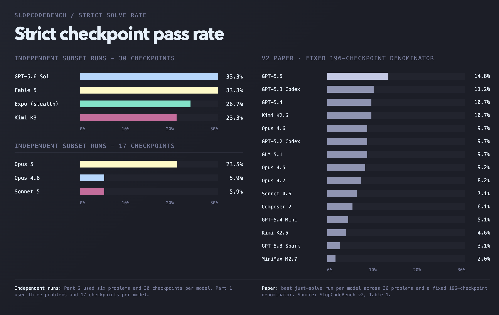

I'll refresh on how slop code bench works real quick, or you can jump to the detailed results.

### Why SlopCodeBench

[You can learn a bit more in the original post](https://github.com/humanlayer/advanced-context-engineering-for-coding-agents/blob/main/benchmarking-opus-5-on-slop-code-bench.md), but briefly: 

SlopCodeBench is a new-ish (March 2026, last update May 2026) long-horizon coding benchmark from [@GOrlanski](https://x.com/GOrlanski)'s lab at UW Madison. It addresses the thing that bothers me most about most coding benchmarks - that even "larger" more complex ones still divulge the whole problem up front. 

Each challenge in SlopCodeBench has multiple "checkpoints" - the model doesn't know the whole problem up front, it has to *evolve* the codebase over time as new requirements are divulged. 

It's a good paper. It's not that long. You should [read it](https://arxiv.org/html/2603.24755v1).

The biggest takeaway from "the fact that SlopCodeBench is 

## the benchmark subset

i pinged Gabe and asked him for a slightly broader subset of problems for this run - this one ran with 6 challenges, with circuit_eval being the overlap challenge. These are subsets, meant to be **directional**, not exhaustive.

- ...fill in....
- circuit_eval — **easy** (8 checkpoints)
- ...fill in....

There's an appendix at the end with all ..fill in... checkpoints explained in detail but I won't put that all here.

and then I ran them across all four models, in parallel, with a fresh context window per checkpoint. All models got the same prompts, and a mix of harnesses:

- Fable - Claude Code 2.1.219
- Sol - Codex CLI 0.145.0
- Kimi K3 - OpenCode 1.18.0
- Expo (stealth) - OpenCode 1.18.0

the metric we decided on for the first benchmark is the **strict pass**: everything new is green including every regression test that was inherited from previous checkpoints. So I carried that forward here.

A model fails a checkpoint if the solution has a **defect** - defects are detected by taking the models output, a CLI to run or in some cases e.g. an api server to poke at, and running a set of held-out black-box tests **against the produced entrypoint**.

- Model writes code for ck1
- Eval harness runs black-box tests against ck1
- Model writes code for ck2
- Eval runs black-box tests for ck1 and ck2
- etc

Again, the strict pass criteria means that if a model bungles something in checkpoint 4, it can't pass the following checkpoints because that failing part of the code carries forward (unless the model indavertently fixes an eval case in checkpoint 6 that was broken in checkpoint 4, but we didn't see this happen in practice).

## live progress

While each model got a few strict passes, they all steadily accumulated defects throughout the run

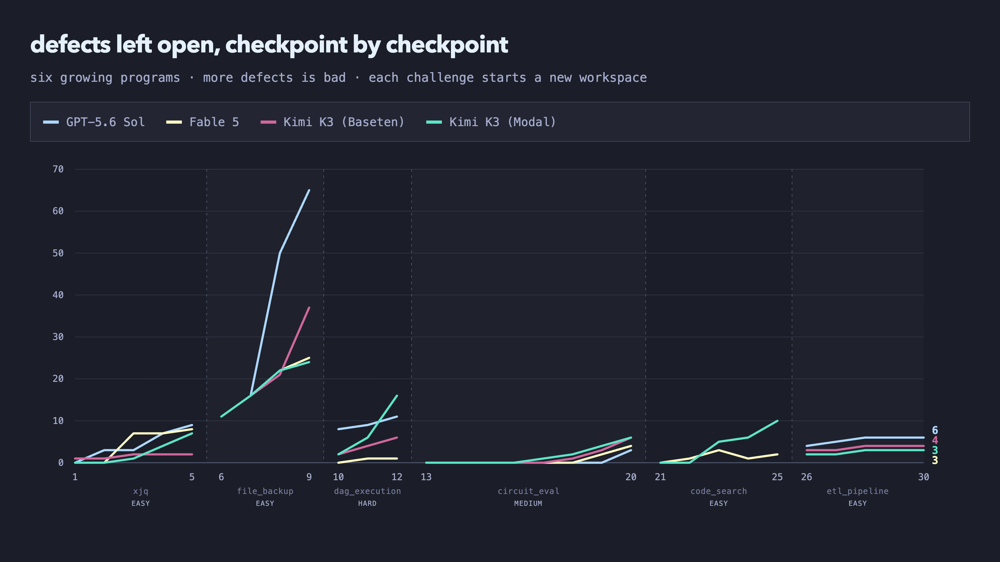

## final result

If our definition of success is "reached the final checkpoint with no defects" then opus 5 failed all three problems, but it failed slightly-less-badly than the other models. 

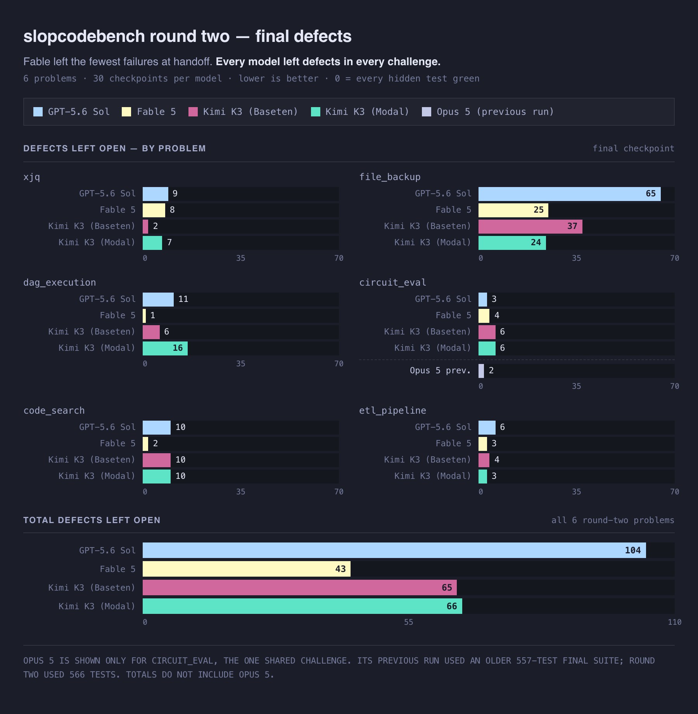

As far as cost vs. defects go, we see a totally different curve from the opus 5 eval. Expo is not plotted because we wont publish $/mtok for that one.

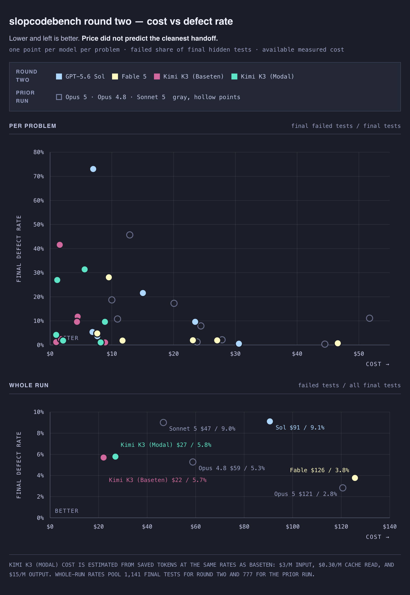

Fable and Sol tied for strict passes with 10 each. If you want a tiebreaker, Fable got 16 **isolated** passes while Sol got only 14.

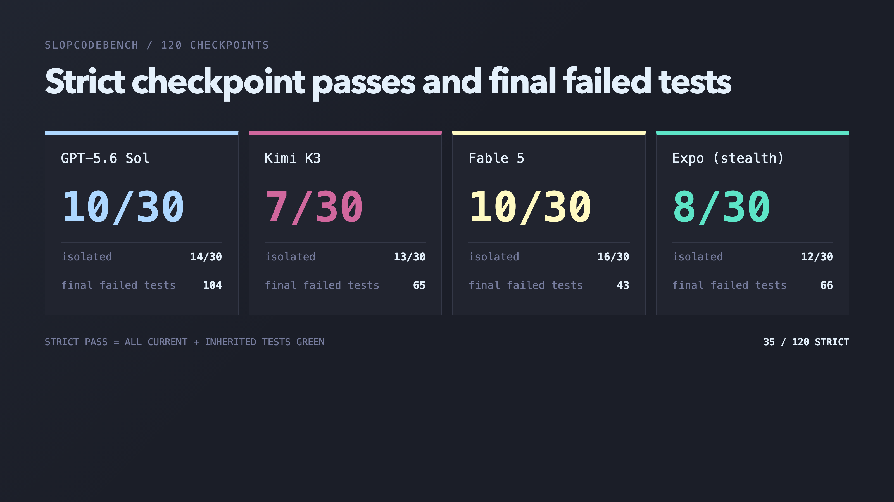

`circuit_eval` was the one challenge shared with the previous run. The newer models earned more strict passes across its eight checkpoints, 

The previous Opus 5 run still **technically** left the fewest final defects, but that result is kinda disqualified by the fact that Opus 5's version of the test suite only has 557 tests, and the newer suite we used for Kimi/Sol/Fable has 566 tests.

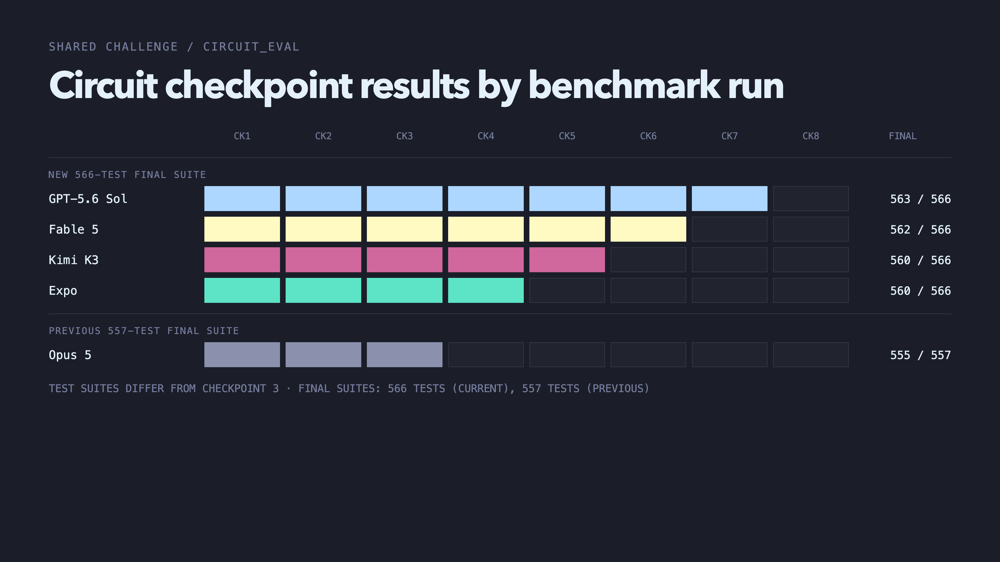

## the slop meter

You can check the previous [post](https://github.com/humanlayer/advanced-context-engineering-for-coding-agents/blob/main/benchmarking-opus-5-on-slop-code-bench.md#the-slop-meter) for a breakdown of the code quality metrics in play here. 

I reproduced the same spread chart from the last post, for the new run. Looks like fable got the highest growth in cloned lines (9x increase betwen ck1 and ck8!!)

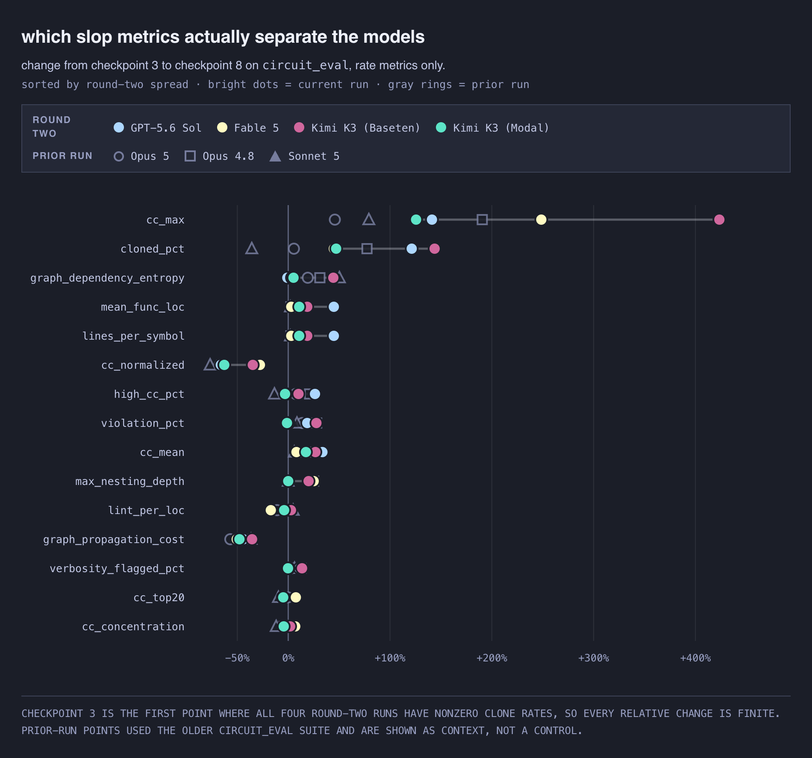

Just as with the Opus 5 bench set, these models are close on growth in most metrics, with Fable growing more in some slop metrics, and Sol/Kimi growing more in others. What's interesting is Sol and Expo did the best at reducing *normalized* cognitive complexity. Somehow not as well as sonnet 5 though...?

Again, I like that these measures are repeatable and don't use a model for judgement. But the link between any one of them and "is this codebase easy to change and evolve" is not really established.

### <take on volume>

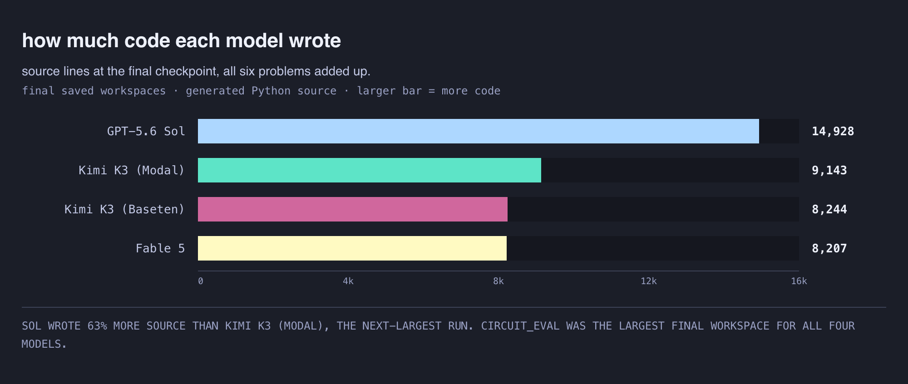

Sol left 1,318 SLOC in persistent Python test files; the other agents also tested their work, but used shell scripts, fixtures, or temporary files that this narrow count excludes. So idk what to do with this chart. I guess the new frontier likes shell-scripts and more black-box / computer-use style testing?! (I think we need to dig into this data more, there may be a bug in reporting here.)

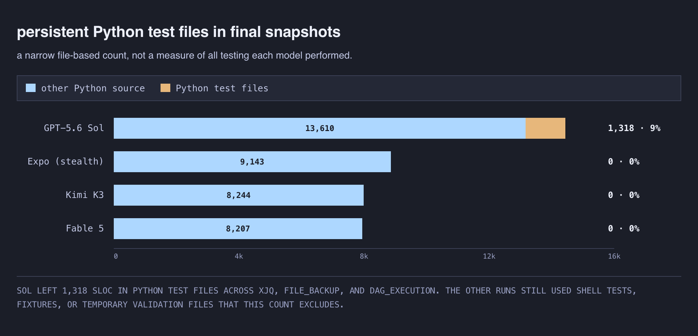

Compact output was not always simple: Kimi had the highest single-function complexity, while Fable had the largest clone share.

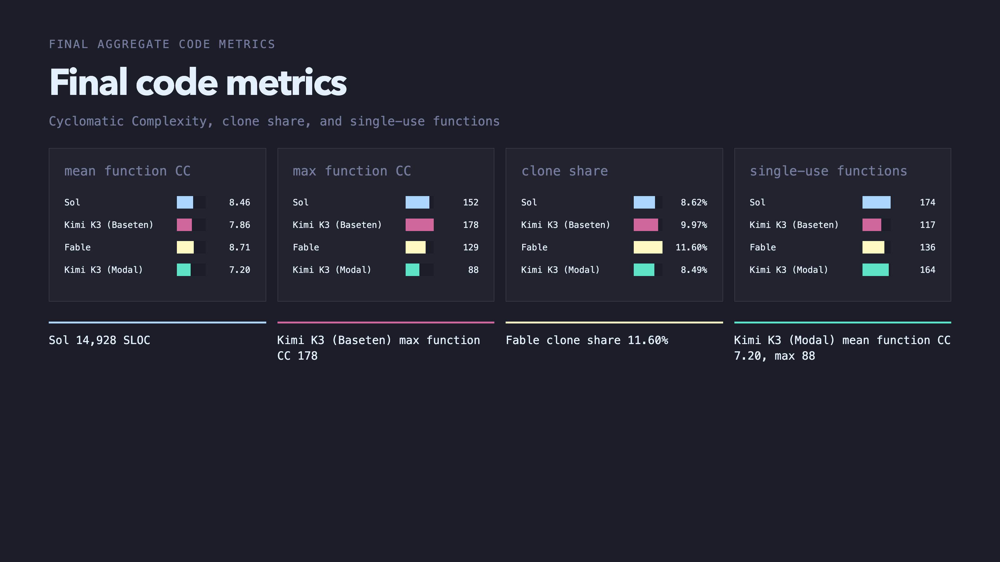

### almost all the code written triggered the slop meter

For all models, a huge majority of the code lines tripped at least one of the benchmark's slop rules. These are the averages across each run's final problem snapshots:

Results from this run:

- Fable 5 — **86%**
- GPT-5.6 Sol — **95%**
- Kimi K3 — **82%**
- Expo — **79%**

Previous results, for context:

- opus 4.8 — **98%**
- opus 5 — **93%**
- sonnet 5 — **89%**

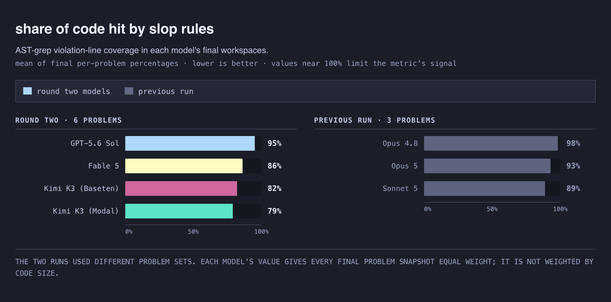

Again, I'd probably say that more than anything else, this is a sign that some of the code quality measures are a bit over-aggressive. But its nice to see the comparison

### Complexity grows over time for all models

All four new runs ended `circuit_eval` with higher mean cyclomatic complexity than the previous three models. 

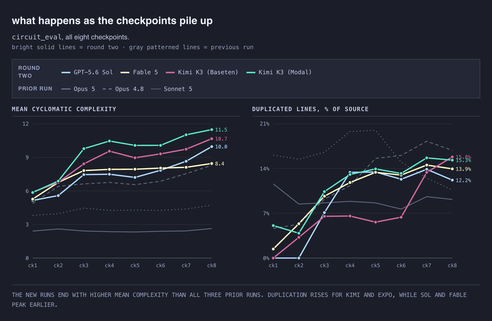

The numbers are all pretty close, but weirdly enough opus 5 had the least duplication by the end of circuit_eval. That could be a sign that opus did a better job of refactoring/reusing as it went, but my guess is that less duplication might also map onto "less consistency". Without digging into the code samples we can't say for sure (and I wanted to get this data out before going deep on that).

The new runs used far fewer callables than prior Opus 5, but their functions were more complex on average.

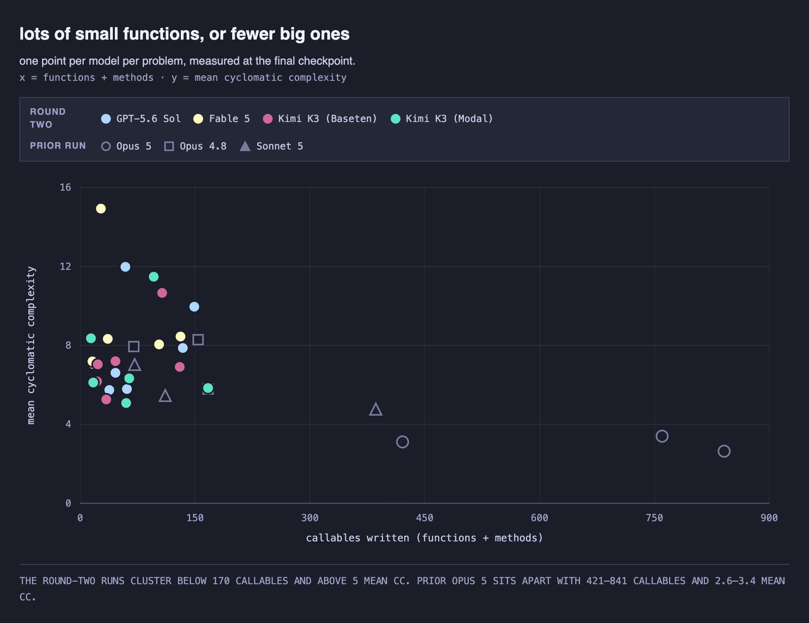

Again - here's what the first three checkpoints of circuit_eval ask for (full listing for all challenges in the appendix at the end):

- **ck1** — a CLI with `--help`, `--version`, a JSON output mode, and a `check` command that parses and validates a `.circ` circuit file. Every signal is a single bit.
- **ck2** — an `eval` command: pass the circuit some inputs, get the outputs back. Still one bit per signal, standard boolean operators.
- **ck3** — signals become **vectors**. `data[7:0]` instead of `data`, plus slicing, indexing, concatenation, new operators, and a width check on every operand.

## back to the shape of a better oracle for software quality

I haven't made progress on this part ([where does the time go!?](./side-quests/where-does-the-time-go.md)), but the idea is to have a small dumb model try each checkpoint.

I might even make sense to have a small model do checkpoint N+1 for EVERY checkpoint and factor that into the pass rates for the smart model's checkpoint N - grading the quality of the codebase left behind.

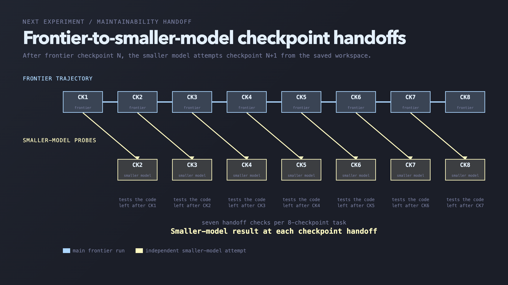

## that's it for now

The frontier is getting better, but I'm still not trusting them to run around lights off in my codebase. I had the vibe since the [week fable launched](https://x.com/dexhorthy/status/2064747631885398231), but this is just more proof that there are hard coding problems.

**Next up: **

I am prototyping a new prompt/flow for the harness - where we incorporate either/both of 

1. Deterministic linters
2. LLM-based "adversarial review" with alternating models

after each checkpoint, and see if it makes the results (strict pass rates) better or worse.

Shameless plug - if you wanna ship code that doesn't suck, but still go really dang fast - check out [humanlayer.com](https://humanlayer.com) and [humanlayer.com/discord](https://humanlayer.com/discord).

good luck.

🫡 -dex

* * *

### Links From This Post

- [Benchmarking Opus 5 on SlopCodeBench](https://github.com/humanlayer/advanced-context-engineering-for-coding-agents/blob/main/benchmarking-opus-5-on-slop-code-bench.md)
- [SlopCodeBench paper](https://arxiv.org/html/2603.24755v1)
- [SlopCodeBench website](https://www.scbench.ai/)
- [SlopCodeBench runner](https://github.com/SprocketLab/slop-code-bench)
- [SlopCodeBench problem catalog](https://github.com/gabeorlanski/scb-problems)
- [Gabe Orlanski on X](https://x.com/GOrlanski)
- [Claude Code](https://github.com/anthropics/claude-code) — harness used for Fable
- [Codex CLI](https://github.com/openai/codex) — harness used for Sol
- [OpenCode](https://github.com/anomalyco/opencode) — harness used for Kimi K3 and Expo
- [Where Does the Time Go?](./side-quests/where-does-the-time-go.md)
- [HumanLayer](https://humanlayer.dev/)

### Appendix: the challenge checkpoints

All 30 checkpoints, in order, condensed from the prompts the models received. Each checkpoint arrives without revealing the later requirements.

**xjq** — easy, developer tools, 5 checkpoints

- **ck1** — Build an XPath 1.0 CLI that reads XML or HTML from stdin, matches elements case-sensitively, normalizes text and attribute results, serializes the first matching XML node, and reports XPath or parse errors.
- **ck2** — Add CSS selectors, including custom direct and descendant `::text` modes, plus `--text` and `--text-all` extraction with defined precedence and whitespace normalization.
- **ck3** — Auto-detect top-level JSON objects and arrays, convert them to a typed XML tree under `<root>`, preserve key order and numeric formatting, and reject keys that cannot form valid XML element names.
- **ck4** — Read from an optional input file in preference to stdin, accept UTF-8 BOMs, ignore extra positional arguments, and add `--first` and compact XML output.
- **ck5** — Add JSON export for XML element results, formalize output-flag precedence, and support XPath unions with defined behavior for text extraction and first-result selection.

**file_backup** — easy, file systems, 4 checkpoints

- **ck1** — Build a YAML-driven backup scheduler that finds daily, weekly, and one-time jobs due within an inclusive time window, applies glob exclusions to mounted files, and emits deterministic JSONL events while simulating backup selection.
- **ck2** — Add optional `full`, `pack`, and `verify` strategies: hash individual files, build deterministic size-bounded GNU tar archives, or verify files without copying, with strategy-specific JSONL events.
- **ck3** — Add backup destinations and SHA-256 incremental state for full and verify jobs, skipping files whose stored copies have not changed; pack jobs remain non-incremental at this checkpoint.
- **ck4** — Make pack jobs incremental by loading existing tar archives, repacking current files under the size limit, and reporting loaded, unchanged, updated, and skipped pack contents.

**dag_execution** — hard, DSL, 3 checkpoints

- **ck1** — Build a CLI that parses a task-pipeline DSL and optional TOML config, type-checks parameters, evaluates control-flow and success expressions, runs required tasks and shell commands in order, enforces workspace and dependency rules, and writes task events plus detailed job JSONL records.
- **ck2** — Add per-task inputs and caches with content, TTL-based stale, and always-use strategies; support global cache settings and forced refreshes while restoring cached output, files, status, and success results.
- **ck3** — Add dynamic cache overrides inside `requires` expressions through `CachedTask(...)`, merging omitted values from the base task and supporting both dotted nested fields and full nested-object replacement.

**circuit_eval** — medium, simulation, 8 checkpoints

- **ck1** — Build a CLI with help, version, JSON output, and a `check` command that parses and validates scalar `.circ` files, including declarations, assignments, operator arity, undefined signals, duplicate assignments, and cycles.
- **ck2** — Add `eval` for scalar two-valued circuits, with explicit or default inputs, extra-input handling, standard Boolean operators, and sorted text or JSON output.
- **ck3** — Add vector signals, sized and unsized literals, indexing, slicing, concatenation, strict width checks, `MUX`/`ITE`, reductions, `EQ`, and binary, hexadecimal, or decimal output formatting.
- **ck4** — Add three-valued evaluation with runtime `X` values, binary-only output, and defined unknown-value behavior for every Boolean, multiplexer, equality, and reduction operator.
- **ck5** — Let `check` and `eval` read `.circ`, JSON, and scalar BENCH circuits through explicit or extension-based format selection, with format-specific parsing and validation.
- **ck6** — Add `stats` for structural metrics, `lint` for unused-input and constant-output checks, and `dot` for deterministic Graphviz export with optional output-cone filtering.
- **ck7** — Add deterministic `cone` extraction, exhaustive `truth-table` output, and exhaustive or seeded randomized `equiv` checks that return counterexamples and a distinct non-equivalence exit code.
- **ck8** — Add deterministic `opt` output with configurable normalization, constant folding, algebra, common-subexpression elimination, dead-code removal, and fan-in passes, plus compact wire renaming, reports, BENCH export, and optional equivalence verification.

**code_search** — easy, developer tools, 5 checkpoints

- **ck1** — Build a Python source-search CLI that applies exact-text and regular-expression rules, skips undecodable files, and emits deterministically ordered JSONL matches with one-based source ranges.
- **ck2** — Extend file discovery and rule filtering to JavaScript and C++, while retaining the same exact and regex matching and output rules.
- **ck3** — Add structure-aware `pattern` rules with required, optional, repeated, and escaped metavariables, reporting capture text and every capture range in deterministic order.
- **ck4** — Add AST node `selector` rules and replacement fixes, with dry-run previews, on-disk application, capture templates, `$MATCH`, escaped dollar signs, and deterministic overlap handling.
- **ck5** — Extend exact, regex, pattern, selector, capture, and fix behavior to Rust, Java, Go, and Haskell, bringing the supported language set to seven.

**etl_pipeline** — easy, data processing, 5 checkpoints

- **ck1** — Build a stdin/stdout JSON CLI that validates and normalizes `select`, `filter`, `map`, `rename`, and `limit` steps, including expression checks, canonical field handling, and structured error paths.
- **ck2** — Add `--execute` to run linear pipelines over in-memory JSON rows with a defined expression language, null and type behavior, column checks, transformed data, and row-count metrics.
- **ck3** — Add nested `branch` steps with first-match routing, an optional final `otherwise` branch, per-branch sub-pipelines, declaration-order concatenation, and nested error paths.
- **ck4** — Add top-level named definitions and parameterized `call` steps, including `params.key` expression access, unknown-definition errors, and direct or indirect recursion checks.
- **ck5** — Add namespaced pipeline libraries and a top-level `compose` list that expands library references and inline step fragments for either normalized output or execution.
